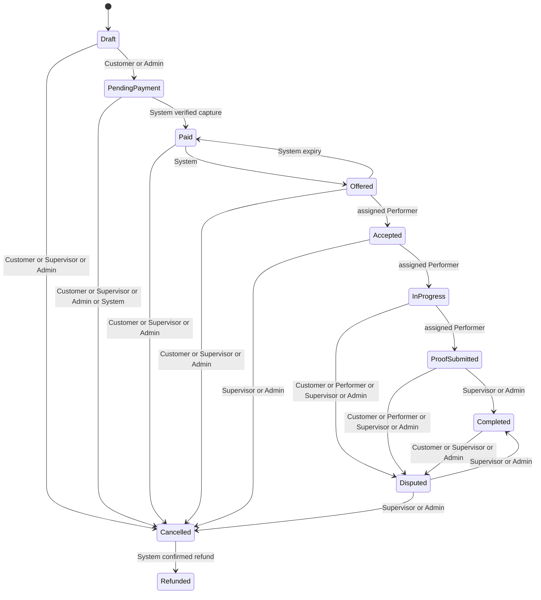
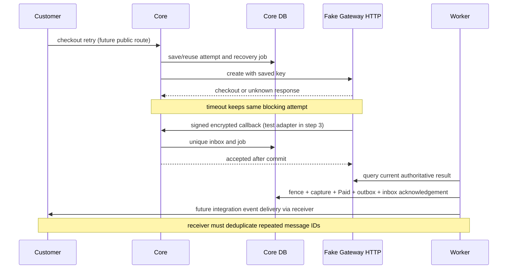

# Design

Status: lean steps 1-7 are implemented locally. The approved final Release regression passed 823 tests with zero failures/skips, followed by a focused delivery regression for a stale-event fix. Local Compose verification is recorded in VERIFICATION.md. No public hosting, real money transfer or live Firebase/Azure/email delivery is claimed.

## Architecture

Implemented: Domain / Application / Infrastructure / Api; separate fake gateway HTTP service using a restricted fake_gateway schema in the same PostgreSQL database. Core and gateway never share transactions. Hosted workers use durable row claims, leases and fencing, without advisory locks. The reduced entity model and seven core steps are in PLAN.md; document actual implementation and environment names (never values) as built.

## State machine diagram

Implemented domain transition/role graph below. Ownership, verified money and assignment guards remain application responsibilities before any future business endpoint is exposed.

Payment, refund, offer, and payout states are separate from booking state. A late charge on a cancelled booking creates a refund request; it does not resurrect the booking. Cancelling a paid booking retains its payment ledger and requests a refund.

## How races, double payment, and duplicate webhooks are prevented

Implemented: booking version checks, named money/capacity checks and transactional refresh-family locking. Future payment/assignment work: conditional capacity allocation, gateway idempotency, durable inbox/outbox and offer/payout transactions. Proposed mechanisms are in PLAN.md; those payment features are not claimed implemented.

## Failure scenarios tested

Latest runs include real PostgreSQL readiness/isolation, monetary constraint rejection, stale booking writes and identity replay races; all passed. The initial Docker-unavailable run is historical. The later step evidence below supersedes the initial skeleton status. Automated scenarios cover crash after charge, gateway timeout, webhook before redirect, payment after cancellation, capacity overflow, offer expiry, payout retries, and refresh-token replay.

## Trade-offs

Revised proposals: paid-only capacity allocation; refund on overflow; unresolved payments block a new attempt; at-least-once external delivery; PostgreSQL-backed hosted workers with row claims, no advisory locks; CSV only in core. Recommend encrypted same-successor refresh recovery; PLAN.md compares it with simpler new-child grace and explicitly describes the branching risk. Reduced tables give up multi-role accounts, invitation workflows and complete historical audit; financial ledgers remain. The user authorized 2a then 2b; stop after the identity commit.

## What I'd do next

After the required backend: real gateway contract validation, operational recovery exercises, stronger provider delivery deduplication, XLSX, and optional admin UI.

## How I used AI

See [AI_LOG.md](AI_LOG.md). Record accepted and rejected recommendations explicitly; proposals are not acceptance.

## Step 1 implementation and honest deployment status

Implemented the eight-project skeleton, pinned SDK and package versions, health-only HTTP hosts, schema-local empty EF migrations and explicit --migrate processes. JSON logs return a locally generated X-Correlation-ID; request logs contain status/duration and omit URLs, headers, IPs, bodies and provider exception details. Shared host/health plumbing is in Infrastructure; FakeGateway reuses that plumbing but never the app context. Domain/Application intentionally contain no business entities yet.

PostgreSQL uses app and fake_gateway schemas with separate migrator owners and restricted runtime logins. Bootstrap creates schemas/roles; each EF history table belongs to its schema. Default table/sequence grants permit future runtime DML only in its own schema. The Docker runtime is non-root; curl is installed only for image health probes. Compose runs explicit one-shot migrations before HTTP services, while normal startup never migrates, even in development. Readiness checks live DB access/schema USAGE, not applied migration version; rollout must separately require successful migrations.

No paid hosting is available: no Railway/Render target, no external deployment and no hosted health URL exist. CI verifies, scans packages and publishes immutable-SHA GHCR images; optional staging/production deployment jobs print a clean skip without hosting secrets. The future deployment hook is only a host-neutral client contract, not an implemented hosting adapter. See [numbered manual deployment steps](DEPLOYMENT.md) and [environment names](ENVIRONMENT.md).

Actual checks: Release build passed with 0 warnings/errors; six HTTP smoke cases passed. Full dotnet test exited 1 because Docker Desktop could not start the required PostgreSQL container (not skipped). Compose configuration and offline EF script generation passed; container build/run, live schema isolation/migration execution, GitHub execution/GHCR push and managed deployment remain unverified. Full evidence and commands are in [VERIFICATION.md](VERIFICATION.md). Do not present the database integration test as passing.

## Step 1 re-verification

With working Docker, corrected a Testcontainers file/directory mapping bug. Full tests passed (4 integration, 3 gateway); Compose built both images, completed explicit migrations, returned healthy on all four HTTP probes and ran both services non-root (UID 1654). Compose shutdown passed. Historical Docker-blocked results above are superseded locally; GitHub/GHCR and external hosting remain unverified. See VERIFICATION.md. User has authorized step 2a followed by step 2b, each in its own commit.

## Step 2a - domain core implemented

BookingStateMachine owns the explicit state/role table; unknown enums, self-transitions and all missing edges/roles return a failed RuleResult with a reason for a future API 409. Accountant has no booking transition privileges. Admin cannot manufacture Paid/Refunded or act as the performer. Booking state setters are private. Actor ownership, verified payment/refund evidence, assignment/deadline checks and transactional side effects remain application work; a role-table success alone is not sufficient authorization for those future operations. No business HTTP routes were added.

Money is a nonnegative SAR long value with checked addition/subtraction. PricingPolicy snapshots server configuration; date add-ons, fixed clamps and exact floor-rounded basis points produce immutable quotes. Percentage multiplication uses quotient/remainder to avoid overflowing an otherwise valid long result. Zero-total checkout is rejected. Voucher eligibility uses an explicit time and usage snapshot; atomic redemption and conditional capacity allocation were added in step 4.

BookingCore migration creates User, Booking, DailyCapacity, Voucher and VoucherRedemption with named checks/FKs/indexes. SQL numeric casts protect the total CHECK expression from bigint intermediate overflow; nullable discount shapes explicitly check IS NOT NULL because SQL UNKNOWN otherwise passes CHECK. EF versions increment on every tracked booking update while retaining the original token in WHERE; raw SQL/bulk writers must explicitly check/increment it. No generic audit or identity behavior was added.

Validation: Release build 0 warnings/errors; full tests 744 domain + 7 integration + 3 gateway, all passed, zero skipped. Includes every state/role pair, monetary/rounding boundaries, voucher expiry/limits, real migration/constraint rejection and stale writes through synchronous/asynchronous saves. An initial test updated unrelated bookings; scoped that invalid write to its own row before rerunning successfully. User then authorized completing step 2b; it is the only next scope.

## Step 2b - identity and replay protection

API exposes only health, Firebase exchange, refresh and authenticated /auth/me; gateway still exposes health only. IFirebaseTokenVerifier has a real Firebase Admin implementation (signature/project/issuer/expiry and checkRevoked=true), with stricter rejection after actual expiry rather than relying on SDK clock-skew allowance. Service-account credential loading explicitly restricts the credential type. Real verifier rejects emulator mode. Tests fake the verifier at the application boundary and also run the actual SDK against local test certificates, OAuth and revocation responses; this is not a live Firebase project check.

Users are UNIQUE(project,UID), never selected by email; Firebase claims cannot grant roles. Login inserts Customer only and preserves an explicitly provisioned role for an existing UID. --provision-user is a separate operator CLI that verifies the exact UID token before changing a role and revoking refresh families; no public role-grant endpoint exists. Operator possession of the server/DB credentials is its trust boundary.

JWTs carry sub/role/jti, expire in ten minutes and validate exact issuer/audience/HS256 signature/lifetime with zero local JWT skew. Refresh secrets have 256 random bits and only SHA-256 hashes are searchable in DB. Rotation locks RefreshFamily in PostgreSQL, then re-reads its token, consumes the parent and inserts exactly one successor (unique ParentId; composite FK prevents cross-family parenting). Store the complete first response encrypted with AES-GCM using parent ID as authenticated data. Same parent/request key within 15 database-clock seconds recovers the identical response; no grace extension or branch is minted. If that child was already consumed, reject recovery rather than resurrecting it. Changed-key/late replay revokes the family and commits before returning 401, including when the request disconnects after the security decision. Stateless access JWTs remain usable until expiry.

The family has an absolute 30-day lifetime; descendants never extend it. A five-second cleanup worker removes expired recovery ciphertext and old rate buckets with idempotent SQL; usable grace is exactly 15 seconds but physical ciphertext cleanup can lag by one timer interval. All replicas need the same recovery key. A thief with both parent and its exact retry key within grace remains indistinguishable from the client. Recovery/signing key rotation is documented operational work, not a hidden claim of transparent multi-key support.

Shared fixed-minute PostgreSQL upserts bound per-IP and verified-account requests, independently of refresh transactions. Keys are HMAC fingerprints, not stored raw IPs/emails. Only successful Firebase verification or possession of a stored refresh secret selects an account budget. There is no failed-login lockout by submitted email. Forwarded IP headers are ignored until a host-specific trusted-proxy policy is configured; ingress IPs conservatively share a budget meanwhile. Templates/notifications, money gateways and later assignment/payout flows remain unimplemented.

Identity acceptance: Release build 0 warnings/errors; final full suite 744 domain + 26 integration (including real PostgreSQL and six actual-SDK controlled-HTTP cases) + 3 gateway tests, 0 failed/skipped. Additional tests prove recovery does not resurrect a consumed child and explicit verified-UID role changes revoke old refresh families. No live service-account credentials or Firebase project were used; actual SDK cryptography/project/expiry/revocation logic ran against generated certificates and controlled HTTP responses.

Post-identity Compose build/migrations/readiness and shutdown passed locally; unconfigured Firebase exchange returned 503 and booking endpoint 404. Upstream Firebase revocation is checked on exchange/provisioning; already-issued local sessions have their own family lifecycle and are not continuously revalidated against Firebase. Live-project exchange/host ingress/trusted-proxy setup and external GitHub/GHCR remain manual verification items.

## Step 3 - checkout, gateway verification and durable delivery

PaymentCheckout locks the owned booking, freezes a server-generated request fingerprint and saves PaymentAttempt plus its recovery JobRun before any HTTP call. A partial unique index permits at most one Creating/Pending/Unknown/Succeeded attempt per booking. Repeated/new double-tap keys reuse it; same-key payload changes conflict. Provider errors/timeouts stay Unknown and block another attempt; only an authoritative final no-charge failure permits another key/attempt. Fingerprints use invariant formatting across replicas. The fake gateway persists idempotency-key/payload binding and a booking-wide unique charge, including across HTTP-host restart. A real provider must promise equivalent key/final-failure semantics; local uniqueness alone cannot stop two external charges.

Gateway checkouts, charges and encrypted events live in fake_gateway with its own restricted credentials and migration. HTTP operations require the shared API key. Simulation covers latency, response failure after commit, query outage, duplicate callback delivery and a configured browser redirect. Failed/Succeeded gateway outcomes are final; a failed checkout cannot later charge. Redirect target is configuration, never request input; redirect cannot mark Core paid.

Webhook envelope version 1 contains a version byte, fresh nonce, GCM tag and ciphertext; HMAC-SHA256 covers the entire raw envelope. Core bounds body size, verifies HMAC before decrypting, validates fields, stores the exact encrypted body/signature and deduplicates UNIQUE(provider,eventId) before acknowledging. Reusing an event ID with different wire bytes is quarantined. Provider retries must reuse the stored event body rather than re-encrypting it under the same ID. This is a documented simulation protocol, not a claim of real HyperPay wire compatibility or transparent multi-key rotation.

Workers re-query the authenticated gateway and check checkout/key/booking/amount/currency/transaction identity before credit. Gateway observations happen outside transactions; inside the commit transaction, job ownership and current booking/attempt state are re-read. Succeeded/Failed local attempts never regress on an older Pending response. Capture ledger, Paid transition/version, BookingPaid outbox intent and inbox acknowledgement commit together. At step 3 BookingPaid targeted an external durable receiver; step 7 replaces production routing with internal durable assignment and recipient delivery. Late payment on Cancelled records the capture plus RefundRequired/AccountantAlert intents without resurrecting the booking. Step 4 added actual capacity/refund execution and enabled protected sale/callback routes; step 7 enables the worker in Compose.

JobRun claims use unique schedule keys, FOR UPDATE SKIP LOCKED, database-clock leases and increasing claim versions. Immediate per-entity jobs use a canonical scheduled slot; retries move AvailableAt rather than insert another schedule. Queries/sends run outside DB transactions. Final writes require the matching live owner/version under a row lock; crashed owners recover after lease expiry. Healthy pending-payment polling resets the error budget, while consecutive failures back off and dead-letter. Clearing EF tracked changes after a rolled-back business write prevents accidentally saving those failed inserts with the retry update. Generic receiver errors are stored as exception-type codes, never payload/secret details.

The outbox publishes over a private HTTP contract using a stable Idempotency-Key, then records acknowledgement under the job fence. Ambiguous acknowledgement can deliver twice; receiver deduplication is required. Gateway callback delivery likewise retries exact saved bytes with leases/backoff/dead letters. Background implementations exist, but Core production activation is intentionally withheld for step 4 and gateway dispatch defaults off. No advisory locks or new packages were added.

Test evidence: 28 new PostgreSQL/HTTP payment cases passed; build 0 warnings/errors. Covers 200-way checkout/pay retries, same/different callback IDs, response-loss/restart, callback before create response/redirect, amount/currency/reference mismatches, forged/GCM-invalid/oversized input, query retry, forced outbox-write rollback, stale leases, lost publication acknowledgement, dead letters, final-failure races, late cancellation and disabled public routes. Fake HTTP hosts restart against the same durable DB; response-loss/storage faults are deterministic failpoints, not literal OS process kills. Full older suites, Docker image/stack rebuild and external providers were not rerun in this step, per the requested faster targeted workflow. See VERIFICATION.md and DEMO_PREP.md.

Ledger scope note: capture records are append-only in the supported application workflow, with no editing/deletion endpoints. No trigger forbids a privileged database owner from rewriting history; do not present that as a database-enforced immutable ledger. Financial uniqueness and state/counter checks are database-enforced separately.

## Step 4 implemented

Capacity is allocated only on verified capture using a bounded UPDATE on the date row, with booking allocation flag and capture/state/outbox committed together. Full dates cancel and create one refund per capture plus accountant alert. Cancellation releases an allocation once. Voucher checks/reservation counts run under the Voucher row lock; capture consumes a reservation, final no-charge failure/cancellation/refund releases it. An uncertain live attempt keeps its reservation until an explicit cancellation or authoritative outcome. Refunds use a stable key, match the full original amount/currency/transaction and only transition Cancelled to Refunded after provider confirmation. Fake gateway persists a unique refund per charge. Public creation/pricing/checkout/read/cancellation use authenticated ownership; browser return is read-only and callbacks require HMAC/AES-GCM. Five focused concurrency/failure cases passed; full regression will follow at the end of the approved timebox.

## Step 5 evidence
Assignment uses one short PostgreSQL mutex-row transaction, active-offer unique indexes and database deadlines. Acceptance and expiry use the same lock order. Three assignment tests passed, including concurrent accept/expiry and scheduler exclusion.
Private Azure Blob grants are exact-path, five-minute and create-only; approved content cannot be overwritten using the upload grant. One real Azurite test passed for private reads, ownership, path isolation and overwrite denial. Azure cloud credentials were unavailable; cloud deployment was not verified. Upload completion enforces size/content-type metadata; malware inspection and privileged storage-owner tampering remain outside this scope.

## Step 6 — completion and payout claims
Completion checks assigned performer, uploaded proof and supervisor-approved proof; one earning per booking commits with completion. Amount is a configured SAR fee capped to the booking total. Weekly batches include available completed earnings through the end of a closed UTC week, including older failed claims. A short shared SQL mutex serializes completion/dispute/payout decisions; this is conservative for low volume. Earning row claims plus partial UNIQUE(EarningId) for Pending/Paid payout items provide a second guarantee. Failed batches release claims; unknown bank outcomes remain Pending. Bank confirmation requires an explicit unique reference. CSV is deterministic, snapshots the configured checksum-valid Saudi IBAN on first export and does not send money. A dispute after export/payment needs accountant investigation, not automatic clawback. Bank-specific CSV certification remains external work.

## Step 7: delivery and operations

BookingPaid routes to a durable Assign job and a separate outbox row/job per configured recipient/channel. OfferCreated and BookingCompleted commit with their business updates; expired offers and cancelled paid events cannot send stale assignment promises. All email/FCM network calls happen in the dispatcher outside transactions. Trusted operator configuration supplies email destinations per user ID; email never selects or links an identity. No recipient/device means that channel is not requested. Arabic/English plaintext templates contain no passport, signed URL or payment credential. Resend uses the stable message ID as its idempotency key; FCM may duplicate after an ambiguous send. Unregistered FCM tokens are invalidated. Bounded retries/backoff and dead letters reuse the existing durable claim protocol. Provider credential/delivery acceptance still needs live smoke tests.

Nightly unique schedules compare the gateway's authenticated paged capture/refund ledger with local rows. The report stores counts and up to 1,000 mismatch entries on JobRun; scans beyond 25,000 remote rows fail visibly. Reads observe a moving ledger, so recent mismatches may be temporary; drain workers and recheck before manual action. Reconciliation reports do not mutate money. Immediate stable-key recovery remains separate. Weekly unique jobs create deterministic per-week/per-performer payout request keys and use the same earning-claim service; actual bank execution remains an operator task.

Core writes a per-instance heartbeat every five seconds and checks it against database time at readiness; older than thirty seconds fails readiness. Configured Azure storage joins readiness, while missing optional storage keeps file endpoints unavailable rather than pretending files work. Explicit OpenTelemetry HTTP/job spans avoid arbitrary URL/query/header/body/identifier tags; an optional OTLP collector is configured by environment. Provider call spans, dashboards and collector deployment are deferred. Hosted-service cancellation leaves durable claims to expire and resume.

During a mixed-version managed rollout, disable workers on old replicas, apply additive migrations, roll all API replicas with workers disabled, then enable the new workers. HTTP can continue accepting durable intents during the brief processing pause. This avoids old binaries claiming newly introduced job kinds; a new enum/CHECK alone is not a complete rolling-worker compatibility strategy. No zero-downtime managed deployment was verified.

## Current failure evidence and limits

- Lost checkout/charge/refund responses recover the original persisted keys; no new charge is opened for an unknown outcome.
- Signed duplicated/out-of-order callbacks re-query the gateway; capture/state/capacity/voucher/outbox commit atomically. A forced outbox write failure rolls them back.
- Payment after cancellation/full capacity records one capture and a durable full refund; slots release once.
- Offer acceptance and expiry compete under the same SQL lock and database deadline; active-booking/performer indexes provide a second guard.
- Concurrent payout batches claim each earning once. Repeated export is stable and remains Pending; confirmed Failed releases claims, Paid never does.
- Actual PostgreSQL/Azurite tests cover identity replay, SDK signature/project/expiry/revocation verification, file ownership, exact-path SAS, private reads and overwrite denial.
- Crash recovery uses deterministic failpoints and HTTP host restarts against persistent databases. No literal process-kill chaos campaign, public-network benchmark or paid production deployment is claimed.

## What I would do next

Select hosting and run the documented managed-host steps; verify live FCM, Azure and Resend delivery beyond the now user-verified Firebase login; certify the CSV with a bank. Add audited role/provisioning and dispute/clawback procedures, mail-address verification/self-service preferences, file malware inspection and retention policies. Migrate registration-token clients to FIDs before removing the narrowly documented deprecated SDK field. Extend reconciliation pagination/report artifacts and renew leases for larger deployments. Add telemetry provider spans and dashboards only after correctness and external acceptance are verified.

Final local deployment evidence: both images built, explicit migration tasks succeeded against the retained volume, four health probes returned 200 and both processes ran as UID 1654. The unconfigured-provider minimal stack does not establish file/email/FCM readiness. Shutdown completed cleanly. See VERIFICATION.md for the caught migration failure and successful additive retry.

Provider references: [Firebase Admin message recipient fields](https://firebase.google.com/docs/reference/admin/dotnet/class/firebase-admin/messaging/message) distinguish registration tokens from FIDs; [Resend idempotency](https://resend.com/changelog/idempotency-keys) supports the stable send key. Neither replaces our durable retry state or establishes universal exactly-once delivery.

Live Firebase setup exposed an adapter initialization bug: assigning a null HTTP factory overwrote the SDK default, while tests always supplied a factory. The adapter now assigns only explicit factories; a separate default-factory test rejects a malformed token without failing initialization. Safe diagnostic logs report only error categories/stages and SQL state, not exception contents or credentials. A successful live Firebase exchange remains unverified until the user retries with their own ID token.

Follow-up evidence supersedes that pending status: the user successfully exchanged their real Firebase ID token and called local /auth/me, observing Customer and a local userId. Live Firebase authentication is now user-verified; other provider delivery and hosted deployment remain unverified. DEMO_PREP.md includes the repeatable walkthrough and precise limits of this proof.

Notification demo preparation: a loopback-only static browser receiver obtains a real FCM recipient token using the public Web app/VAPID configuration. Its fixed asset allowlist cannot serve repository files or Admin credentials, and it does not hold API JWTs or the gateway key. PowerShell registers the token through the existing authenticated endpoint. A separate operator helper validates /auth/me and injects a per-user email mapping through an ignored environment-based Compose override, retaining Firebase configuration. The email helper never sends directly; fresh verified payment events drive both providers through the existing outbox. Resend's own-account test sender avoids buying a domain while limiting demo delivery to that account's email. Provider error logs include only HTTP status or FCM category. Actual provider receipts still require user setup and observation; local syntax/HTTP/transport checks are not live push/email verification.
