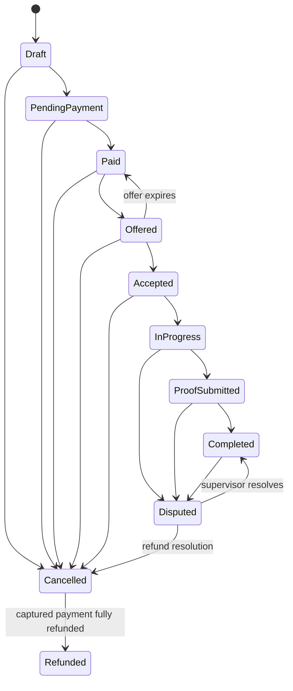

# Design

Status: step 1 implemented only; no step-2 authorization. Local build and HTTP smoke checks passed, but Docker-dependent verification and external deployment remain blocked. See [PLAN.md](PLAN.md) for the revised decisions and acceptance tests.

## Architecture

Proposed: Domain / Application / Infrastructure / Api; separate fake gateway HTTP service using a restricted fake_gateway schema in the same PostgreSQL database. Core and gateway never share transactions. Hosted workers use durable row claims, leases and fencing, without advisory locks. The reduced entity model and seven core steps are in PLAN.md; document actual implementation and environment names (never values) as built.

## State machine diagram

Proposed normal path below. Exceptional transitions, role matrix, and guards remain subject to approval in PLAN.md.

Payment, refund, offer, and payout states are separate from booking state. A late charge on a cancelled booking creates a refund request; it does not resurrect the booking. Cancelling a paid booking retains its payment ledger and requests a refund.

## How races, double payment, and duplicate webhooks are prevented

Future work only: concrete business schema constraints, row locks and lock order, conditional updates, gateway idempotency, durable inbox/outbox and token-family transactions. Proposed mechanisms are in PLAN.md; none of those business mechanisms are implemented in step 1.

## Failure scenarios tested

Step-1 health smoke tests ran; real PostgreSQL test could not start because Docker is unavailable. No business failure tests have run. Record each future scenario, test name, observed invariant, and remaining limitation here after implementation. Planned scenarios include crash after charge, gateway timeout, webhook before redirect, payment after cancellation, capacity overflow, offer expiry, payout retries, and refresh-token replay.

## Trade-offs

Revised proposals: paid-only capacity allocation; refund on overflow; unresolved payments block a new attempt; at-least-once external delivery; PostgreSQL-backed hosted workers with row claims, no advisory locks; CSV only in core. Recommend encrypted same-successor refresh recovery; PLAN.md compares it with simpler new-child grace and explicitly describes the branching risk. Reduced tables give up multi-role accounts, invitation workflows and complete historical audit; financial ledgers remain. Step 1 only has been authorized; wait before step 2.

## What I'd do next

After the required backend: real gateway contract validation, operational recovery exercises, stronger provider delivery deduplication, XLSX, and optional admin UI.

## How I used AI

See [AI_LOG.md](AI_LOG.md). Record accepted and rejected recommendations explicitly; proposals are not acceptance.

## Step 1 implementation and honest deployment status

Implemented the eight-project skeleton, pinned SDK and package versions, health-only HTTP hosts, schema-local empty EF migrations and explicit --migrate processes. JSON logs return a locally generated X-Correlation-ID; request logs contain status/duration and omit URLs, headers, IPs, bodies and provider exception details. Shared host/health plumbing is in Infrastructure; FakeGateway reuses that plumbing but never the app context. Domain/Application intentionally contain no business entities yet.

PostgreSQL uses app and fake_gateway schemas with separate migrator owners and restricted runtime logins. Bootstrap creates schemas/roles; each EF history table belongs to its schema. Default table/sequence grants permit future runtime DML only in its own schema. The Docker runtime is non-root; curl is installed only for image health probes. Compose runs explicit one-shot migrations before HTTP services, while normal startup never migrates, even in development. Readiness checks live DB access/schema USAGE, not applied migration version; rollout must separately require successful migrations.

No paid hosting is available: no Railway/Render target, no external deployment and no hosted health URL exist. CI verifies, scans packages and publishes immutable-SHA GHCR images; optional staging/production deployment jobs print a clean skip without hosting secrets. The future deployment hook is only a host-neutral client contract, not an implemented hosting adapter. See [numbered manual deployment steps](DEPLOYMENT.md) and [environment names](ENVIRONMENT.md).

Actual checks: Release build passed with 0 warnings/errors; six HTTP smoke cases passed. Full dotnet test exited 1 because Docker Desktop could not start the required PostgreSQL container (not skipped). Compose configuration and offline EF script generation passed; container build/run, live schema isolation/migration execution, GitHub execution/GHCR push and managed deployment remain unverified. Full evidence and commands are in [VERIFICATION.md](VERIFICATION.md). Do not present the database integration test as passing.
